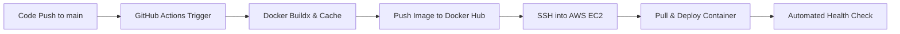

#  Automated CI/CD Web Server Deployment

A hands-on DevOps project demonstrating a complete, automated Continuous Integration and Continuous Deployment (CI/CD) pipeline using GitHub Actions, Docker Hub, and an AWS EC2 instance.

---

##  Architectural Pipeline Flow



1. **Code Modification**: Developer updates code (e.g., `index.html`) locally and pushes to the `main` branch.
2. **Continuous Integration (CI)**: GitHub Actions builds a modern, lightweight Nginx container utilizing Docker Buildx caching optimization.
3. **Registry Upload**: The runner builds two separate image tags (`latest` and a unique Git `commit SHA`) and securely pushes them to Docker Hub.
4. **Continuous Deployment (CD)**: GitHub securely handshakes into an AWS EC2 host using ultra-secure ED25519 SSH keys, terminates the orphan container runtime, fetches the newest container layer, binds to public HTTP Port `80`, and executes an automated health check validation.

---

##  Stack Components

*   **Application Server**: Nginx Alpine (`FROM nginx:alpine`)
*   **Automation Platform**: GitHub Actions Platform (Node 24 runtime ecosystem)
*   **Remote Server Engine**: AWS EC2 Instance running Ubuntu 26.04 LTS
*   **Secure Remote Access**: OpenSSH with native ED25519 cryptographic signatures

---

##  Required GitHub Secrets Configuration

To run this workflow without authentication errors, the following encrypted environment variables must be registered under **Repository Settings > Secrets and variables > Actions**:

| Secret Name | Value Context | Description |
| :--- | :--- | :--- |
| `DOCKERHUB_USERNAME` | `<user_name>` | Your Docker Hub identity namespace |
| `DOCKERHUB_TOKEN` | `<token>` | Docker Personal Access Token with Write scope |
| `SERVER_HOST` | `<ip>` | Public IP Address of your active AWS EC2 host |
| `SERVER_USER` | `<hostname>` | Root administrative host username |
| `SERVER_SSH_KEY` | `<private_key>` | Complete multi-line raw ED25519 private key block |

---

##  Host Server Pre-Requisites (AWS Console EC2 Setup)

### 1. Networking Inbound Firewall Profiles
Ensure the attached AWS Security Group explicitly allows the following ingress parameters:
*   **Port 22 (SSH)**: Source `0.0.0.0/0` (Allows GitHub Runner connectivity)
*   **Port 80 (HTTP)**: Source `0.0.0.0/0` (Allows global public web browsing requests)

### 2. Linux Environment Verification
Connect to your cloud provider node terminal instance and run this sequence once to allow non-sudo Docker access flags:
```bash
sudo apt-get update && sudo apt-get install -y docker.io
sudo usermod -aG docker ubuntu
newgrp docker
```

---

##  Triggering an Automated Deployment

1. Modify your web layout or headers directly inside `webserver-docker/index.html`.
2. Stage, commit, and push your tracking logs to GitHub:
   ```bash
   git add webserver-docker/index.html
   git commit -m "feat: updated website homepage content header"
   git push origin main
   ```
3. Open the **Actions** tab on your GitHub UI repository panel to track validation logs.
4. Once completed, browse your public IP mapping reference root path endpoint directly: `http://<ip>` (Ensure you browse over plain `http` to prevent browser cache `https` reset anomalies).
